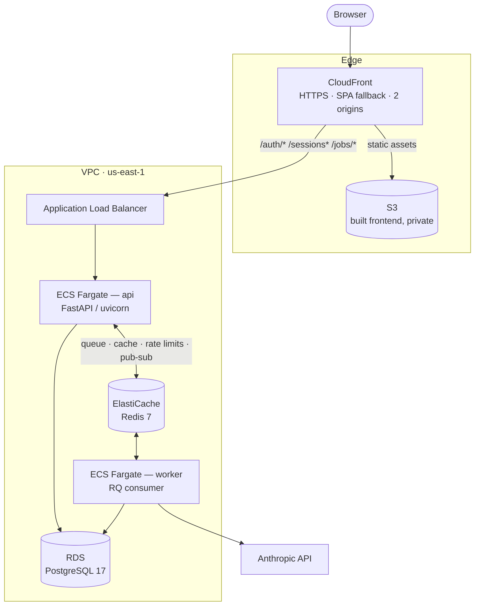
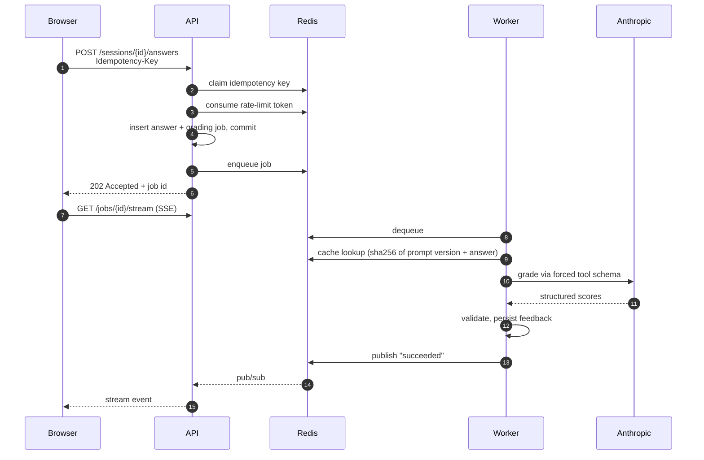

# AI Interview Simulator

Practice technical and behavioral interviews against an AI that scores your answers against a rubric and writes specific feedback.

[](https://github.com/yhanafi2023/ai-interview-simulator/actions/workflows/ci.yml)

React · TypeScript · FastAPI · PostgreSQL · Redis · Docker · Terraform · AWS

---

## What it does

Pick a track and difficulty, answer questions in free text, and get back scores across several rubric dimensions plus written strengths and improvements.

The interesting engineering problem isn't the model call — it's building around a dependency that is **slow** (3–15 seconds), **expensive** (metered per token), and **unreliable** (rate limits, timeouts, truncated responses). Most of this codebase exists to make that dependency safe to depend on.


---

## Architecture



One CloudFront distribution fronts both the static frontend and the API, so the browser sees a single origin — which removes CORS entirely, keeps the refresh cookie first-party, and provides HTTPS without a custom domain.

All infrastructure is Terraform. There is no NAT gateway: tasks run in public subnets with no inbound access except from the load balancer, which trades a layer of defense in depth for roughly $32/month. That tradeoff and the rest are written up in [`infra/README.md`](infra/README.md).

### Grading flow



The model call never happens inside an HTTP request. The endpoint writes the answer, queues a job, and returns `202` immediately; a background worker does the slow part and pushes the result over Server-Sent Events, with client-side polling as a fallback.

---

## Engineering decisions worth reading the code for

| Decision | Where | Why |
|---|---|---|
| Grading on a job queue | `app/tasks/grading.py` | A 15-second request can't be retried safely and risks load balancer timeouts. Queued work is retryable and survives a deploy. |
| Idempotent submissions | `app/services/idempotency.py` | A client-supplied deterministic key means a double-click or network retry replays the original response instead of creating a second answer and a second paid API call. |
| Atomic rate limiting | `app/services/rate_limit.py` | Token buckets run as a Lua script in Redis so check-and-decrement is indivisible. Two concurrent requests can't both decide they're under the limit. |
| Fail-open cache and limiter | `app/services/cache.py` | An unreachable Redis makes the system slower, not broken. A deliberate availability-over-strictness choice. |
| Forced tool schema for the LLM | `app/services/llm.py` | The model answers through a JSON schema rather than prose, and the payload is validated with Pydantic before anything is written. Model output is untrusted input. |
| Versioned prompts in cache keys | `app/services/prompts.py` | Changing the prompt invalidates cached grades automatically, and stored feedback records which version produced it. |
| Refresh token rotation | `app/api/auth.py` | Refresh tokens rotate on use and are tracked by family. Replaying a consumed token means it was stolen, so the whole family is revoked. |
| Request IDs across processes | `app/logging_config.py` | A `ContextVar` carries one ID through the API and into the queued job, so a single request's path across two containers is greppable — and it's attached to Sentry issues as a tag. |
| Types generated from OpenAPI | `frontend/src/types/api.ts` | CI fails if the committed TypeScript drifts from the backend schema, so frontend and backend cannot disagree about a response shape. |
| Transactional test isolation | `backend/tests/conftest.py` | Tests run against real PostgreSQL inside a rolled-back transaction, using savepoint join mode so application code can call `commit()` normally. |
| Migrations as a one-off task | `infra/migrate.tf` | A rolling deploy briefly runs two containers. Migrations on startup would race two `alembic upgrade head` processes against one database. |

A longer walkthrough, including the full request lifecycle and the known limitations, is in [`docs/architecture.html`](docs/architecture.html).

---

## Stack

| Layer | Choices |
|---|---|
| Frontend | React 19, TypeScript (strict), Vite, Tailwind CSS, React Router, TanStack Query, react-hook-form + Zod |
| Backend | Python 3.13, FastAPI, SQLAlchemy 2.0, Alembic, Pydantic v2, RQ, PyJWT, argon2 |
| Data | PostgreSQL 17, Redis 7 |
| Infra | Docker, Terraform, AWS (ECS Fargate, ECR, RDS, ElastiCache, ALB, S3, CloudFront, VPC, IAM, Secrets Manager, CloudWatch) |
| Quality | pytest, Vitest + Testing Library, MSW, Playwright, Ruff, ESLint, Prettier, GitHub Actions |
| Observability | Structured JSON logging, Sentry (API, worker, browser) |

---

## Repository layout

```
backend/
  app/
    api/          route handlers (auth, questions, sessions, jobs, metrics, health)
    models/       SQLAlchemy models
    services/     grading, llm, prompts, cache, rate_limit, idempotency, budget
    tasks/         RQ job functions
    logging_config.py, observability.py, config.py
  migrations/     Alembic revisions
  tests/
frontend/
  src/
    features/     auth context, protected routes
    pages/        Dashboard, Login, Register, InterviewRoom
    lib/          api client, auth store, job stream, sentry
    types/        generated from the OpenAPI schema
  e2e/            Playwright specs
infra/            Terraform: vpc, security_groups, rds, redis, ecs, alb, frontend, secrets, iam
docs/             architecture guide, AWS verification evidence
openapi.yaml      the contract both sides are generated from
```

---

## Running it locally

**Requirements:** Docker, Node 20+, Python 3.13, [uv](https://docs.astral.sh/uv/).

```bash
git clone https://github.com/yhanafi2023/ai-interview-simulator.git
cd ai-interview-simulator
cp .env.example .env          # then add your ANTHROPIC_API_KEY
```

Bring up Postgres, Redis, the API, and the worker:

```bash
docker compose up -d --build
docker compose exec api alembic upgrade head
docker compose exec api python -m app.seed
```

Then the frontend:

```bash
cd frontend
npm install
npm run dev                   # http://localhost:5173
```

The API is on `http://localhost:8000`, with interactive docs at `/docs`.

Grading works without an Anthropic key — the service falls back to a deterministic heuristic grader and logs that it did so.

### Checks

```bash
make check                    # lint, types, and both test suites
cd frontend && npx playwright test
```

### Regenerating the API types

The frontend's types are generated from the backend's OpenAPI schema and committed. After changing a response model:

```bash
cd frontend && npm run gen:api
```

CI fails if the committed output doesn't match the current schema.

---

## Deploying to AWS

Requires the AWS CLI configured and Terraform installed. `ANTHROPIC_API_KEY` and `SENTRY_DSN` are read from `.env` by the Makefile — no manual exporting.

```bash
make infra-up          # Terraform apply (~10 min on a cold build)
make image-push        # build for linux/amd64, push to ECR tagged sha-<commit>
make infra-up          # point the task definitions at the new tag
make db-migrate
make db-seed
make frontend-deploy   # build, sync to S3, invalidate the entry point
```

Or `make deploy` for the whole sequence in the correct order.

```bash
make infra-down        # destroy everything
make infra-audit       # verify nothing billable survived the teardown
make infra-cost        # last 7 days from Cost Explorer
```

Images are tagged by git SHA with immutable ECR tags, so "what is deployed" is a question with an exact answer, and rollback is a tag that still exists.

### Cost

The stack runs at roughly **$0.07/hour** — about $25/month if left running, which for a single-user project isn't worth it. So it's built to be disposable: `make infra-up` rebuilds everything in about ten minutes, and `make infra-down` removes it. Verifying an afternoon's work costs well under a dollar.

Billing guardrails were configured before the first `terraform apply`: a monthly budget with forecast alerts, and an audit script that checks AWS directly for resources `terraform destroy` might have missed — snapshots, unattached elastic IPs, secrets in a recovery window.

---

## Known limitations

Documented deliberately, with the fix, rather than left for someone to find:

- **No NAT gateway.** Tasks sit in public subnets protected only by security groups. Fix: private subnets with a NAT gateway, or VPC endpoints.
- **CloudFront reaches the ALB over plain HTTP.** Viewer traffic is encrypted; the internal hop isn't, because the ALB has no certificate. Fix: ACM certificate on a domain plus an HTTPS listener.
- **Redis has no transit encryption or auth token.** A single-node ElastiCache cluster supports neither. Fix: a replication group with `transit_encryption_enabled`.
- **Terraform state is local.** Fix: an S3 backend with locking and encryption.
- **One CloudFront behavior per API router.** Adding a router means remembering to add a path pattern. Fix: mount the API under a single `/api` prefix.
- **Teardown-friendly RDS settings** — backups off, no final snapshot, no deletion protection. Correct for a stack that lives an afternoon, wrong for production.
- **No eval harness for the grading prompt.** Prompt changes can't currently be measured as better rather than merely different.

---

## License

MIT
